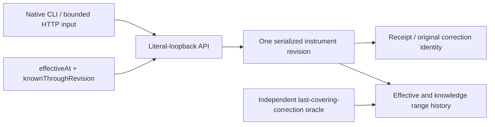

# Point-in-Time Instrument Reference Lab

A C#/.NET API and CLI for one synthetic instrument. Ask two explicit questions: **when is the value effective?** and **through which committed knowledge revision may the query know corrections?**

A late correction can change a later query while leaving an earlier as-known query unchanged. Receipt `observedAt` is metadata; it is never silently treated as external publication time or actual database commit time.

Synthetic, literal-loopback-only lab. No real feed, vendor data, historical price reconstruction, orders, account connection, prediction or production service.

## .NET 11 technology refresh — source preparation only

The `v0.1.0-preview.4` working branch pins SDK11.0.100, `net11.0`, stable C#15 and Core/ASP.NET11.0.0. This is a maintenance candidate, with no feature, schema, temporal contract or performance change claimed.

Only source and documentation have been prepared. The three managed lockfiles and four runtime notice identities still describe the delivered .NET10 baseline; they have deliberately not been regenerated or relabeled. Building, executing or packaging this branch remains gated on one admitted shared SDK11 handoff, actual new runtime identities/notices, and reviewed project05 controls and kernel containment. SDK metadata is not acquisition, compatibility or runtime proof.

Npgsql10.0.3, xunit.v3 4.0.3, all application/test code, semantic fixtures and the original signing trust root remain fixed. The existing preview.3 downloads and their accepted source/CI evidence below remain the usable published release. Do not treat this prepared branch as a new download or deployment.

## Decision and proof first

| Decision | Executable evidence |
| --- | --- |
| Knowledge follows committed revision, including equal observed times | Concurrent corrections receive unique serialized revisions; independent last-covering-correction oracle |
| Late information must not leak into old queries | Query the same effective instant at revision 1 and revision 2 after a correction |
| Correct both temporal dimensions | Actual PostgreSQL tstzrange + int8range exclusion; overlapping effective history is allowed across disjoint knowledge ranges |
| Preserve source and original corrections | Durable identity/digest/result, immutable receipt history and carried-value provenance |
| Uncertain commit is not a new correction | Kill an owned API before/after commit, then resolve with the same identity |
| A parsed response may still be wrong | Client validates returned intent, instrument, effective time, cutoff and origin revision |

## History page completeness — v0.1.0-preview.3

The [v0.1.0-preview.3 release](https://github.com/pouriajamali/point-in-time-reference-lab/releases/tag/v0.1.0-preview.3) binds its native packages and source archive to signed source `8c844fe917b0d7b1f4389a635bd7950f1cb839b7`. Its exact-tag Windows/Linux CI and actual signed downloads are separate from the earlier local checkpoints described below. Local source unit runs recorded 51 passing cases on both Windows and Linux, including the twelve new validator vectors. The actual Windows/Linux archives each passed eight package checks and seven wire responses at signed local application checkpoint90130fe; the retained fourteen-case PostgreSQL suite and new seventeen-correction scenario also passed on Linux. It rejects a history page unless it contains exactly `min(16, headRevision-afterRevision)` original receipts with consecutive committed revisions starting at `afterRevision+1`. Receipt validation stays in place. An empty tail with `afterRevision=16` and `headRevision=17` is incomplete even though its entries are trivially ordered.

This requirement follows this one-instrument v1 transaction protocol: knowledge revisions use the locked committed head plus one in the same transaction as the original receipt. Storage `row_id` identities may have gaps. Completeness is relative to each page's reported head; it does not authenticate the server or provide a snapshot across pages.

The same twelve validator vectors produced exactly five designated omission failures against the serviced baseline on each OS and passed with the repair. A seven-response loopback wire fixture has also been authored. The new PostgreSQL fixture declares sixteen initial receipts and a seventeenth late correction with an older `observedAt`; it compares both continuation pages, every original receipt/intent, effective queries at cutoffs16/17, and a separate SQL inventory against an independent input-list oracle. At checkpoint90130fe, the packaged wire fixture passed on both OSes. The new Linux database scenario passed with17 committed corrections,19 SQL history rows and18 active segments, plus its declared page/point/replay/conflict checks. The existing fourteen-case integration script and ownership tests remain unchanged.

To verify a freshly built native candidate, use:

```sh
python3 tools/knowledge_boundary.py --wire-only --cli ./reference --out artifacts/wire-history
python3 tools/knowledge_boundary.py --fixtures artifacts/services --cli ./reference --out artifacts/knowledge-boundary
```

Wire mode works with the native Windows executable as `--cli reference.exe`; database mode requires the existing non-root Linux profile and its five pinned fixture archives. Use fresh output folders. The four .15 runtime notice/content identities have been reconciled from the selected signed archives, normalized identities and original notice bytes. Native package checks and wire/database oracles passed at the local application checkpoint. The published preview.3 packages come from their own exact-tag native CI at `8c844fe`; the six private bf05702 assets remain historical local evidence and are not relabeled. Earlier [preview.2 downloads](https://github.com/pouriajamali/point-in-time-reference-lab/releases/tag/v0.1.0-preview.2) remain available.

## Connection ownership correction

This version closes a newly allocated connection if opening fails or is cancelled. [Read the ownership decision, executable counterexamples and evidence limits](docs/CONNECTION-OWNERSHIP.md).

## Run the preview

Preview version: [`v0.1.0-preview.3`](https://github.com/pouriajamali/point-in-time-reference-lab/releases/tag/v0.1.0-preview.3). Download **[Windows x64](https://github.com/pouriajamali/point-in-time-reference-lab/releases/download/v0.1.0-preview.3/point-in-time-reference-lab-v0.1.0-preview.3-win-x64.zip)**, **[Linux x64](https://github.com/pouriajamali/point-in-time-reference-lab/releases/download/v0.1.0-preview.3/point-in-time-reference-lab-v0.1.0-preview.3-linux-x64.tar.gz)** or [source](https://github.com/pouriajamali/point-in-time-reference-lab/releases/download/v0.1.0-preview.3/point-in-time-reference-lab-v0.1.0-preview.3-source.zip). Get the [checksums](https://github.com/pouriajamali/point-in-time-reference-lab/releases/download/v0.1.0-preview.3/SHA256SUMS.txt), [checksum signature](https://github.com/pouriajamali/point-in-time-reference-lab/releases/download/v0.1.0-preview.3/SHA256SUMS.txt.sig) and [public key](https://github.com/pouriajamali/point-in-time-reference-lab/releases/download/v0.1.0-preview.3/SIGNING-PUBLIC-KEY.pub); verify downloaded bytes with [PROVENANCE.md](PROVENANCE.md) before executing them. Local builds and CI artifacts are separate from published releases.

Windows PowerShell, from the extracted package:

```powershell
.\reference.exe --help
python tools/fetch_services.py --out artifacts/upstream
if ($LASTEXITCODE -ne 0) { throw 'Fixture fetch failed' }
$linuxHere = (wsl -d Ubuntu-24.04 -- wslpath -a (Get-Location).Path).Trim()
if ($LASTEXITCODE -ne 0) { throw 'Existing Ubuntu WSL required' }
wsl -d Ubuntu-24.04 -- python3 "$linuxHere/tools/prepare_linux.py" --archives "$linuxHere/artifacts/upstream" --out "$linuxHere/artifacts/services"
if ($LASTEXITCODE -ne 0) { throw 'Fixture preparation failed' }
python tools/integration.py --cli reference.exe --fixtures artifacts/services --out artifacts/demo
if ($LASTEXITCODE -ne 0) { throw 'Demo failed; retain its evidence' }
Get-Content artifacts/demo/receipt.json
```

Native Linux x64:

```sh
python3 tools/fetch_services.py --out artifacts/upstream &&
python3 tools/prepare_linux.py --archives artifacts/upstream --out artifacts/services &&
python3 tools/integration.py --cli ./reference --fixtures artifacts/services --out artifacts/demo &&
cat artifacts/demo/receipt.json
```

The self-contained API/CLI needs no installed SDK. The full demo needs Python 3.12+, existing Ubuntu24.04 x64 (Windows uses an existing Ubuntu-24.04 WSL distribution) and five separately fetched checksum-pinned PostgreSQL/support archives. Helpers only extract archives and own fresh processes/data; no package/system-service/OS-feature installation, cloud, paid account or extension is required. In particular, this single-instrument shape does not install btree_gist.

The automated demo launches the API/CLI natively on the calling OS and PostgreSQL in existing Linux/WSL. It checks fourteen cases with an independent SQL/history oracle, including 23 committed corrections and 1,866 point checks. This is correctness evidence, not a Windows/Linux speed comparison.

Keep the whole demo folder private: `connection.private.json` contains a fresh temporary lab password. The supervisor stops only its owned processes; scratch/logs remain for review. Use new output paths rather than overwriting evidence.

## Understand one correction

With an owned lab database/API running (see [runbook](docs/RUNBOOK.md)), the client itself needs no database password:

```powershell
.\reference.exe ingest http://127.0.0.1:8123 examples/first.json
.\reference.exe ingest http://127.0.0.1:8123 examples/late-correction.json
.\reference.exe query http://127.0.0.1:8123 2024-01-15T00:00:00Z 1
.\reference.exe query http://127.0.0.1:8123 2024-01-15T00:00:00Z 2
```

The first query retains the old `tickSizeMicros=10000`; the second sees `5000`. Both receipt inputs deliberately have the same observed time. A missing or future committed knowledge cutoff is rejected. No implicit latest/wall-clock-only query hides that decision.

Amounts are exact positive integer millionths: tick size in synthetic quote units, multiplier in synthetic quantity per contract. For example, 10,000 tick-size micros means 0.01 synthetic quote unit; 1,000,000 multiplier micros means a factor of 1. No floating-point value is admitted. Instants are UTC Z at whole-second or exactly six-digit microsecond precision, normalized to six digits. Effective intervals are half-open.



## Build

Release source: exact SDK10.0.404 / .NET10.0.15 / C#14 / Npgsql10.0.3. Local source restore/build/unit runs passed with all three managed lockfiles unchanged. Source units and published native-package proof are separate gates:

```sh
dotnet restore PointInTimeReference.slnx --locked-mode
dotnet build PointInTimeReference.slnx -c Release --no-restore -m:1
dotnet run --project tests/Reference.Tests -c Release --no-build -- -result-xml artifacts/unit.xml
```

Private preparation from the sealed local package source adds `-p:DisableTransitiveFrameworkReferenceDownloads=true` to avoid prefetching framework families that no project directly references. Required Core/ASP.NET .15 packs, default signature validation and audit-all remain enabled. Hosted CI uses its ordinary online restore route.

See [temporal contract](docs/CONTRACT.md), [decisions](docs/ADR.md), [runbook](docs/RUNBOOK.md), [notices](NOTICE.md) and [provenance](PROVENANCE.md). Native local execution, local cross-builds, public CI and actual public downloads are separate evidence. Original code is MIT; private/shared assets and career materials remain outside scope.

[CI resource policy](docs/CI-POLICY.md): documentation-only changes get real lightweight document/pipeline checks; source, tag and manual runs retain native validation. Release runtime/source assets stay pinned to their exact tag; a later documentation commit does not change or relabel them.

## Source readability and historical runtime

The ownership correction and C# layout changes have separate reviewable commits. Formatting preserves complete syntax, token text and values, comments and directives. It is not compiled-byte or performance equivalence evidence. The historical [v0.1.0-preview.1 runtime source](https://github.com/pouriajamali/point-in-time-reference-lab/tree/d797dd185d06d6d28f57662bf7b97b2cf2cf6b25) remains pinned at `d797dd185d06d6d28f57662bf7b97b2cf2cf6b25`; use the actual bundle manifest and release tag for this version's source.

The separate [maintainer actionlint build](docs/ACTIONLINT-BUILD.md) now consumes the exact admitted shared artifacts; all150 consumer negatives and both native default/direct valid/invalid controls passed locally. Its guarded default/direct routes, original-source and20-module graph identities are separate from the three-component application runtime. Those local receipts retain their original source boundaries; public preview.3 availability is established separately by its release downloads and exact-tag hosted CI.

## Build-time sealed linter

Fresh CI/contributor lint imports the exact reviewed public sealed archive; no
producer drive/private receipts or local compiler are required. Managed task
checkouts retain the canonical gate. See [native profile and signed input setup](docs/ACTIONLINT-BUILD.md).
The shared sealed input was published and independently downloaded at [its tooling tag](https://github.com/pouriajamali/data-admission-gate/releases/tag/tooling-actionlint-v1.7.12-go1.26.11-r1); [producer bootstrap CI](https://github.com/pouriajamali/data-admission-gate/actions/runs/43275123686) applies to that producer only. Consumer CPU1 and app packages use their own exact preview.3 CI evidence.


## SDK11 consumer input source candidate

The separate SDK11/.NET11/C#15 maintenance route is source preparation only.
The shared producer04 normal input module/catalog retain byte-identical identities
`d9c690d8c82825b018c04089c279036829d3baf2534c2634bba84910c415a37d` /
`686c6c778f7841e6015fa401f3892b853df80e3341fbb5d02b27c682887c1c78`.
Only the accepted Linux producer fact `757abf2d3dde65d10cd895cfc97eaeccb7fc11e8685b94ad046e6a8ec8829007`
and its `0452e1f3b4f2662d57e9b273428bb37ab0c5a733551a92394ca2a4e8b9b4ac08`
acceptance may supply Linux input history. Windows normal input remains denied.
This does not establish consumer compatibility, current own kernel control or SDK readiness.

The proposed own controller `tools/ci05/ci_route05.py` retains CPU1/4GiB/64tasks,
Linux swap0 and the original absolute1200s row deadline. It records an actual
stopped worker with retained pidfd before continuation; frozen63e consumerAdmission
binds its own current held evidence, tracked contract/profile and complete source-pin
table. Historical producer IDs/UID do not become consumer IDs/UID. The shared
`transport(rid,directory,context)` remains inside the own nonroot capped main worker;
no downloaded SDK is executed by the shared input library and no global SDK/PATH,
cache, job, event or time budget is added.

Actual net11 managed locks, exact native Core/Host and ASP.NET runtime packages,
raw signed versus normalized identities, signatures, notices and current advisories
remain separate blocking product inputs. All original51unit/8package/7wire cases perOS,
Linux14case/23correction/1866point and17newcorrection/19row/18active/page/replay/conflict
checks and verifier8test/27process scope remain required. Existing preview.3 downloads
and runtime evidence are unchanged. One consolidated exact source/runtime/public
approval is still required before apply, acquisition, SDK/native work, CI or publication.


## Local maintenance route without Actions (2026-11-17)

The owner has disabled Actions for this maintenance task. The separate
`tools/ci05/local_windows05.py` consumer route uses the actual local Windows11
client identity and its own suspended-child Job proof (CPU1/4GiB/64 tasks),
source commit and original1200s clock. It reuses existing exact SDK11 bytes and
historical input/local compatibility receipts; it does not impersonate a
GitHub runner or turn other consumers' evidence into project05 admission.
The .NET11 OS table dated2026-09-28 omits26H2, so local test results are observed
compatibility evidence, not a new Microsoft support certification.

Five actual SDK11 project-graph evaluations passed under the own CPU1 Job.
The fixed managed phase attempts actual private Core/test locks and the original
51 units while requiring exact managed version/content identity. It does not
apply incomplete product locks. Actual net11 CLI locks,
raw/normalized package identity, signatures/notices/advisory and the complete
original product tests are still required before a new package is released.
The accepted preview.3 release remains the delivery baseline. CI was not run
per owner instruction. No workflow, protection, trust or billing setting is
changed; any later authorized push must use a signed `[skip ci]` HEAD after
its actual trigger set is checked.

Local outcome (2026-11-17): the next private test restore stopped with NU1101
before unit execution: Core/ASP.NET runtime inputs for both RIDs and the
SDK-enumerated WindowsDesktop runtime were absent from the isolated reused feed.
The shared accepted native catalog covers three Linux inputs; Windows SDK
acceptance does not qualify Windows native NuGet archives. No implicit-download
avoidance flag was added. Failed-restore private data pruned the two
Microsoft.Extensions Abstractions10.0.0 entries while preserving the other18
version/content pairs; it has not replaced the frozen source locks.
No new preview.4 package or successful unit/build claim is made.
