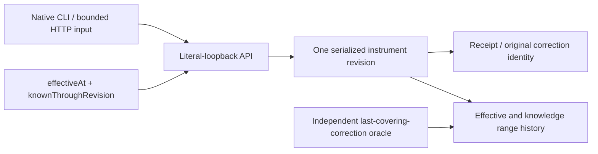

# Point-in-Time Instrument Reference Lab

A C#/.NET API and CLI for one synthetic instrument. Ask two explicit questions: **when is the value effective?** and **through which committed knowledge revision may the query know corrections?**

A late correction can change a later query while leaving an earlier as-known query unchanged. Receipt `observedAt` is metadata; it is never silently treated as external publication time or actual database commit time.

Synthetic, literal-loopback-only lab. No real feed, vendor data, historical price reconstruction, orders, account connection, prediction or production service.

## Decision and proof first

| Decision | Executable evidence |
| --- | --- |
| Knowledge follows committed revision, including equal observed times | Concurrent corrections receive unique serialized revisions; independent last-covering-correction oracle |
| Late information must not leak into old queries | Query the same effective instant at revision 1 and revision 2 after a correction |
| Correct both temporal dimensions | Actual PostgreSQL tstzrange + int8range exclusion; overlapping effective history is allowed across disjoint knowledge ranges |
| Preserve source and original corrections | Durable identity/digest/result, immutable receipt history and carried-value provenance |
| Uncertain commit is not a new correction | Kill an owned API before/after commit, then resolve with the same identity |
| A parsed response may still be wrong | Client validates returned intent, instrument, effective time, cutoff and origin revision |

## Run the preview

Published preview: [`v0.1.0-preview.1`](https://github.com/pouriajamali/point-in-time-reference-lab/releases/tag/v0.1.0-preview.1). Download **[Windows x64](https://github.com/pouriajamali/point-in-time-reference-lab/releases/download/v0.1.0-preview.1/point-in-time-reference-lab-v0.1.0-preview.1-win-x64.zip)**, **[Linux x64](https://github.com/pouriajamali/point-in-time-reference-lab/releases/download/v0.1.0-preview.1/point-in-time-reference-lab-v0.1.0-preview.1-linux-x64.tar.gz)** or [source](https://github.com/pouriajamali/point-in-time-reference-lab/releases/download/v0.1.0-preview.1/point-in-time-reference-lab-v0.1.0-preview.1-source.zip). Get the [checksums](https://github.com/pouriajamali/point-in-time-reference-lab/releases/download/v0.1.0-preview.1/SHA256SUMS.txt), [checksum signature](https://github.com/pouriajamali/point-in-time-reference-lab/releases/download/v0.1.0-preview.1/SHA256SUMS.txt.sig) and [public key](https://github.com/pouriajamali/point-in-time-reference-lab/releases/download/v0.1.0-preview.1/SIGNING-PUBLIC-KEY.pub); verify downloaded bytes with [PROVENANCE.md](PROVENANCE.md) before executing them. Local builds and CI artifacts are separate from published releases.

Windows PowerShell, from the extracted package:

```powershell
.\reference.exe --help
python tools/fetch_services.py --out artifacts/upstream
if ($LASTEXITCODE -ne 0) { throw 'Fixture fetch failed' }
$linuxHere = (wsl -d Ubuntu-24.04 -- wslpath -a (Get-Location).Path).Trim()
if ($LASTEXITCODE -ne 0) { throw 'Existing Ubuntu WSL required' }
wsl -d Ubuntu-24.04 -- python3 "$linuxHere/tools/prepare_linux.py" --archives "$linuxHere/artifacts/upstream" --out "$linuxHere/artifacts/services"
if ($LASTEXITCODE -ne 0) { throw 'Fixture preparation failed' }
python tools/integration.py --cli reference.exe --fixtures artifacts/services --out artifacts/demo
if ($LASTEXITCODE -ne 0) { throw 'Demo failed; retain its evidence' }
Get-Content artifacts/demo/receipt.json
```

Native Linux x64:

```sh
python3 tools/fetch_services.py --out artifacts/upstream &&
python3 tools/prepare_linux.py --archives artifacts/upstream --out artifacts/services &&
python3 tools/integration.py --cli ./reference --fixtures artifacts/services --out artifacts/demo &&
cat artifacts/demo/receipt.json
```

The self-contained API/CLI needs no installed SDK. The full demo needs Python 3.12+, existing Ubuntu24.04 x64 (Windows uses an existing Ubuntu-24.04 WSL distribution) and five separately fetched checksum-pinned PostgreSQL/support archives. Helpers only extract archives and own fresh processes/data; no package/system-service/OS-feature installation, cloud, paid account or extension is required. In particular, this single-instrument shape does not install btree_gist.

The automated demo launches the API/CLI natively on the calling OS and PostgreSQL in existing Linux/WSL. It checks fourteen cases with an independent SQL/history oracle, including 23 committed corrections and 1,866 point checks. This is correctness evidence, not a Windows/Linux speed comparison.

Keep the whole demo folder private: `connection.private.json` contains a fresh temporary lab password. The supervisor stops only its owned processes; scratch/logs remain for review. Use new output paths rather than overwriting evidence.

## Understand one correction

With an owned lab database/API running (see [runbook](docs/RUNBOOK.md)), the client itself needs no database password:

```powershell
.\reference.exe ingest http://127.0.0.1:8123 examples/first.json
.\reference.exe ingest http://127.0.0.1:8123 examples/late-correction.json
.\reference.exe query http://127.0.0.1:8123 2024-01-15T00:00:00Z 1
.\reference.exe query http://127.0.0.1:8123 2024-01-15T00:00:00Z 2
```

The first query retains the old `tickSizeMicros=10000`; the second sees `5000`. Both receipt inputs deliberately have the same observed time. A missing or future committed knowledge cutoff is rejected. No implicit latest/wall-clock-only query hides that decision.

Amounts are exact positive integer millionths: tick size in synthetic quote units, multiplier in synthetic quantity per contract. For example, 10,000 tick-size micros means 0.01 synthetic quote unit; 1,000,000 multiplier micros means a factor of 1. No floating-point value is admitted. Instants are UTC Z at whole-second or exactly six-digit microsecond precision, normalized to six digits. Effective intervals are half-open.



## Build

Exact SDK10.0.403 / .NET10.0.14 / C#14 / Npgsql10.0.3:

```sh
dotnet restore PointInTimeReference.slnx --locked-mode
dotnet build PointInTimeReference.slnx -c Release --no-restore -m:1
dotnet run --project tests/Reference.Tests -c Release --no-build -- -result-xml artifacts/unit.xml
```

See [temporal contract](docs/CONTRACT.md), [decisions](docs/ADR.md), [runbook](docs/RUNBOOK.md), [notices](NOTICE.md) and [provenance](PROVENANCE.md). Native local execution, local cross-builds, public CI and actual public downloads are separate evidence. Original code is MIT; private/shared assets and career materials remain outside scope.

[CI resource policy](docs/CI-POLICY.md): documentation-only changes get real lightweight document/pipeline checks; source, tag and manual runs retain native validation. Published runtime tags and release assets remain unchanged.
